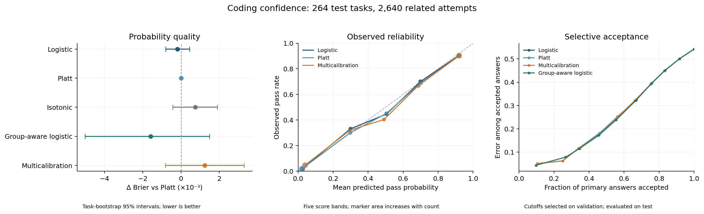

# Coding Confidence | Calibration and Routing

Tests whether calibrating a small correctness model improves coding-answer probabilities and selective escalation.

## Quick Start

Use Python 3.11 or 3.13. The [analysis notebook](analysis.ipynb) has saved outputs and runs from the included numerical records, without dataset downloads or model API calls.

```bash
git clone https://github.com/Smokeybear10/coding-confidence-calibration.git
cd coding-confidence-calibration
python -m venv .venv
source .venv/bin/activate
python -m pip install -r requirements.txt
python -m research.reproduce --output work/replay
jupyter lab analysis.ipynb
```

Use a new output directory for each CLI run. The notebook uses `work/notebook/` for disposable tables and figures.

## What It Does

Uses 1,055 LiveCodeBench tasks from CALIBRI[^1], with ten recorded primary answers per task. Each answer becomes sixteen measurements of prompt/code size, token log probabilities, syntax-tree structure, and invalid or missing output. The label is the publisher's pass/fail result; this study does not execute generated programs.

A standardized, regularized logistic regression predicts passing. Platt scaling fits a shared adjustment on separate calibration tasks. A multicalibration-inspired loop[^2] then adds offsets to sufficiently supported, overlapping group-and-score slices. Validation chooses correction settings and a routing cutoff; 264 separate tasks evaluate the frozen methods.

Nine methods are compared, including isotonic calibration, score-bin-only correction, group-aware logistic regression, and token-only and structure-only feature ablations. The alternate model's recorded answer is used to evaluate escalation and can also fail. [Methods and feature definitions](METHODS.md) specify the exact prediction target, splits, corrections and metrics.

## Results

The reference evaluates 2,640 primary answers from 264 test tasks.

| Method | Brier score | Log loss | Five-bin ECE |
| --- | ---: | ---: | ---: |
| Logistic | 0.111126 | 0.340996 | 1.62% |
| Logistic + Platt | 0.111316 | 0.341450 | 1.43% |
| Logistic + Platt + multicalibration | 0.112552 | 0.344726 | 2.02% |
| Group-aware logistic | 0.109738 | 0.337902 | 1.42% |
| Isotonic | 0.112068 | 0.393181 | 1.90% |

Lower is better. **Neither additional calibration stage established a clear Brier improvement.** Platt minus logistic was +0.000190, with paired 95% interval [-0.000443, +0.000799]. Multicalibration minus Platt was +0.001236 [-0.000818, +0.003303]. The lower point estimate for group-aware logistic also has an interval versus Platt spanning zero.



Intervals resample entire tasks with their related answers. They are conditional on the fitted models, with no simultaneous correction across method comparisons. Tables include [all methods](results/metrics.csv), [paired comparisons](results/comparisons.csv), [subgroup diagnostics](results/slices.csv), [nonempty-program sensitivity](results/subsets.csv), and [routing curves](results/risk_coverage.csv).

The default logistic, Platt and multicalibration cascades all pass 51.17% with 24.77% test escalation. Primary-only passes 45.80%; alternate-only passes 51.06%. The default policy targets 30% escalation on validation, so its test rate can differ. These are descriptive recorded-answer replays, with no measured cost or latency advantage.

## Reproduce the Results

Refit the confidence models and corrections from the included feature records, retaining the recorded task splits:

```bash
python -m research.reproduce --refit --output work/refit
python -m research.figures --results work/refit --output work/refit/diagnostics.png
```

Both offline modes verify reference checksums, check probabilities against the recorded predictions, and write metric-by-metric comparisons. The [publication check](REPRODUCIBILITY.md) records a maximum replay probability difference of 5.56e-14 and refit difference of 4.15e-11. Tiny changes at exact score-band boundaries change one calibration-set isotonic ECE diagnostic; that difference is retained and explained.

The [raw-data walkthrough](reconstruction/cursor-confidence-walkthrough.ipynb) shows one actual prompt, its ten programs, token records, and feature extraction. Rebuilding from source needs approximately 466 MB of pinned public Parquet files and local caching:

```bash
python -m research.run --output work/raw-rebuild
```

Source downloads verify the six SHA-256 hashes in `research/data.py`. The numerical archive is sufficient for model-stage replay and refitting; it cannot independently verify source extraction. `requirements.txt` describes the publication environment. `requirements-research.txt` preserves the older experiment's dependency record.

Checks run without source-data downloads:

```bash
python -m unittest discover -s research -t . -v
```

## Project Structure

```text
analysis.ipynb                    # Offline results and diagnostics
reconstruction/                  # Raw-record teaching walkthrough
research/
  data.py                        # Pinned sources and sixteen features
  methods.py                     # Predictors, auditing, patches and routing
  reference.py                   # Checksummed numerical archive
  reproduce.py                   # Offline replay and refit
  figures.py                     # Diagnostics from result tables
  run.py                         # Full public-source rebuild
  runs/a8630092fa9e/              # Frozen reference and compressed predictions
results/                         # Replayed tables, protocol and figure
reproduction/                    # Measured publication checks
```

## Limits

This is one benchmark and an already-inspected split. Sibling answers stay together, but benchmark contamination and related problem families remain possible. There are 612 empty extracted programs in the test sample; these easy-to-identify failures affect aggregate results, and extraction was not independently audited.

The allowed groups are predefined. Support restrictions and convergence on calibration cells do not establish population multicalibration. Binned diagnostics depend on boundaries and changing cell support. The routing rule uses a validation budget rather than a learned economic optimum.

This independent public-data reconstruction uses no private Cursor data or production integration. New notebooks and reruns document the existing sample; they do not establish what ran during an earlier fellowship or prospective performance.

[^1]: [CALIBRI public dataset and benchmark attribution](https://huggingface.co/datasets/lavis-nlp/CALIBRI), revision `7a4a7dc7aceb1b4a426c48761d0f128f2daf6a54`. Dataset and underlying benchmark terms continue to apply.
[^2]: Hebert-Johnson, Kim, Reingold and Rothblum (2018), [Multicalibration: Calibration for the (Computationally-Identifiable) Masses](https://proceedings.mlr.press/v80/hebert-johnson18a.html). The finite-group implementation here is an empirical application, without a claimed population guarantee.

Built by Thomas Ou
