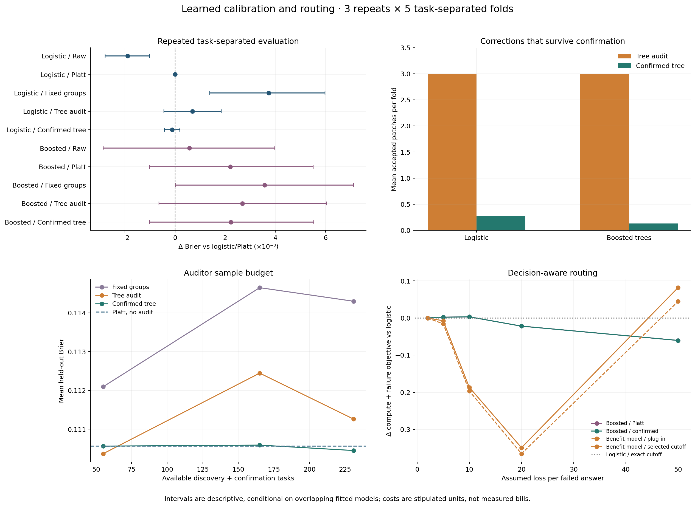

# Coding Confidence | Learned Calibration and Routing

Studies when discovered subgroup corrections generalize and when confidence estimates improve escalation decisions.

## Quick Start

Use Python 3.11 or 3.13. The [advanced notebook](advanced_analysis.ipynb) reads included results and has saved outputs; no model API or source-data download is needed.

```bash
git clone https://github.com/Smokeybear10/coding-confidence-calibration.git
cd coding-confidence-calibration
python -m venv .venv
source .venv/bin/activate
python -m pip install -r requirements.txt
jupyter lab advanced_analysis.ipynb
```

## What It Does

Uses CALIBRI's recorded LiveCodeBench outputs[^1]: 1,055 tasks, ten primary answers per task, sixteen measurements of prompt/code size, token log probabilities, syntax structure and missing outputs, plus publisher pass/fail labels.

Three repeats of five task-separated outer folds compare logistic and histogram-boosted predictors. Each has raw, Platt, fixed-group, learned-tree and confirmation-filtered variants. Score calibration, subgroup discovery, correction confirmation, policy selection and testing use separate task roles. All sibling answers stay together.

A regression-tree auditor learns feature-defined regions with systematic residuals. Its conservative variant checks proposals on fresh task blocks before applying a shrunk correction. The study also varies auditor sample budgets, reweights held-out feature mixtures, and uses synthetic known-probability controls to study overfitting and detection power.

Routing is evaluated separately. A benefit model predicts the recorded alternate-minus-primary outcome, then competes with confidence thresholds selected on validation, including an exact search over every score boundary. Cost scenarios charge both generation stages when escalating. [Advanced methods](ADVANCED_METHODS.md) give the complete design and limitations.

## Results

The repeated study has 15 outer fits per confidence pipeline. Brier and log loss are lower-is-better; AUC is averaged within folds.

| Predictor / calibration | Mean Brier | Mean log loss | Mean AUC |
| --- | ---: | ---: | ---: |
| Logistic / raw | 0.108675 | 0.330056 | 0.928759 |
| Logistic / Platt | 0.110565 | 0.336791 | 0.928759 |
| Logistic / fixed groups | 0.114299 | 0.345870 | 0.923475 |
| Logistic / tree audit | 0.111261 | 0.337754 | 0.927503 |
| Logistic / confirmed tree | 0.110451 | 0.336504 | 0.928721 |
| Boosted / raw | 0.111144 | 0.337367 | 0.925081 |
| Boosted / Platt | 0.112768 | 0.342301 | 0.925081 |
| Boosted / fixed groups | 0.114134 | 0.354429 | 0.921359 |
| Boosted / tree audit | 0.113253 | 0.345119 | 0.924028 |
| Boosted / confirmed tree | 0.112788 | 0.342266 | 0.925060 |

**More flexible prediction or calibration did not automatically improve probability quality.** Raw logistic has the lowest mean Brier in this configuration. The confirmation filter accepts six corrections across thirty auditor fits; the reused-data tree auditor takes all three allowed updates in every fit.



The [paired contrasts](advanced_results/paired_comparisons.csv) use task-averaged losses across repeats. Their intervals are descriptive and conditional on overlapping fitted models: they exclude refitting/split uncertainty and shared-training dependence. Three repeats are not three independent replications, and there is no simultaneous-coverage claim.

### Why the confirmation stage matters

Under a synthetic calibrated null with 120 calibration tasks, tree corrections introduce mean known-probability MSE about 0.0130; the confirmation filter makes no correction in those ten runs. It still makes a false correction in one of ten null runs at size 360. With a real hidden interaction and 1,080 tasks, unfiltered correction is more powerful: MSE about 0.00512 versus 0.01121 for the filter. Confirmation trades power for resistance to selected noise.


These are explicitly synthetic controls, not additional coding-benchmark observations. [Learning curves](advanced_results/sample_complexity.csv) and [mixture stress tests](advanced_results/mixture_shift.csv) examine related limitations on the historical sample.

### Calibration versus decision value

With primary/alternate costs set to 1/4 and failure loss set to 20, the plug-in benefit policy lowers the mean stipulated objective by about 0.365 relative to exact-threshold logistic/Platt; its descriptive task-bootstrap interval is [-0.474,-0.258]. At failure loss 50, the mean difference is +0.045 and its interval spans zero. Benefits are scenario-dependent, not measured production savings.

[Decision costs](advanced_results/decision_costs.csv), [cost contrasts](advanced_results/cost_comparisons.csv), validation cutoffs, rescues/regressions and [per-task losses](advanced_results/task_costs.csv.gz) accompany the results. The original eleven-budget threshold grid remains alongside the stronger exact-threshold comparator.

## Reproduce the Study

Full runs use the included numerical archive and fixed protocol:

```bash
python -m research.advanced --output work/new-advanced
python -m research.simulations --output work/new-simulations
python -m research.advanced_figures --results work/new-advanced --simulations work/new-simulations
```

Use fresh output directories. `--smoke` runs one outer fold or one simulation seed and is marked incomplete. Protocol snapshots, source/environment records, fold assignments, learned rules, probabilities, cost losses and numerical manifests are saved. The study produces 316,500 probability rows from **1,055 task clusters**; rows across models/repeats are not independent data.

Checks run without source-data downloads:

```bash
python -m unittest discover -s research -t . -v
```

## Original Reference

The earlier nine-method single-split experiment remains available in the [analysis notebook](analysis.ipynb), [original result tables](results/metrics.csv), [methods](METHODS.md) and [reproduction record](REPRODUCIBILITY.md). It established no clear Brier gain from Platt or multicalibration. Replay or refit it separately with `python -m research.reproduce --output work/reference` and the optional `--refit` flag.

The [raw-data walkthrough](reconstruction/cursor-confidence-walkthrough.ipynb) shows one real prompt, ten programs, token records and feature extraction. `python -m research.run --output work/raw-rebuild` rebuilds from approximately 466 MB of pinned public Parquet sources with SHA-256 checks. Offline model-stage experiments do not independently verify extraction or rerun benchmark tests.

## Project Structure

```text
advanced_analysis.ipynb           # Repeated study and known-probability controls
analysis.ipynb                    # Original reference analysis
research/
  advanced_protocol.json         # Fixed experiment settings and scope
  advanced.py                    # Grouped evaluation and decision policies
  auditors.py                    # Learned rules and fresh-block confirmation
  simulations.py                 # Correlated-task null/interaction controls
  advanced_figures.py             # Advanced diagnostics
  data.py, methods.py             # Features and original methods
  reference.py, reproduce.py      # Checksummed archive, replay and refit
  runs/a8630092fa9e/              # Original frozen reference
advanced_results/                # Repeated-study artifacts
simulation_results/              # Separate synthetic results
results/, reproduction/          # Earlier reference and publication checks
```

## Limits and Scope

All benchmark experiments reuse the inspected historical sample. There are no new independent coding tasks, prospective outcomes, private Cursor data or production integration. Repeated splitting reduces dependence on one partition but cannot eliminate benchmark contamination or related problem families.

Calibration settings are fixed configurations with different capacities, not optimally tuned representatives of every method. Confirmation uses small-sample approximate bootstrap intervals and establishes no exact false-discovery or population multicalibration guarantee. Mixture shifts and costs are stipulated scenarios. Extraction failures and publisher-label limitations remain; the original test sample includes 612 empty programs.

The exact-threshold comparator was added after an initial exploratory run. Both protocol versions and the original grid results are retained. The extension is a new, separately dated implementation and evaluation of existing ideas[^2][^3], not recovered evidence of an earlier fellowship's exact implementation.

[^1]: [CALIBRI dataset](https://huggingface.co/datasets/lavis-nlp/CALIBRI), pinned revision `7a4a7dc7aceb1b4a426c48761d0f128f2daf6a54`. Dataset and benchmark terms continue to apply.
[^2]: Hebert-Johnson et al. (2018), [Multicalibration: Calibration for the (Computationally-Identifiable) Masses](https://proceedings.mlr.press/v80/hebert-johnson18a.html).
[^3]: Detommaso et al. (2024), [Multicalibration for Confidence Scoring in LLMs](https://proceedings.mlr.press/v235/detommaso24a.html). Additional related work is discussed in [ADVANCED_METHODS.md](ADVANCED_METHODS.md).

Built by Thomas Ou
