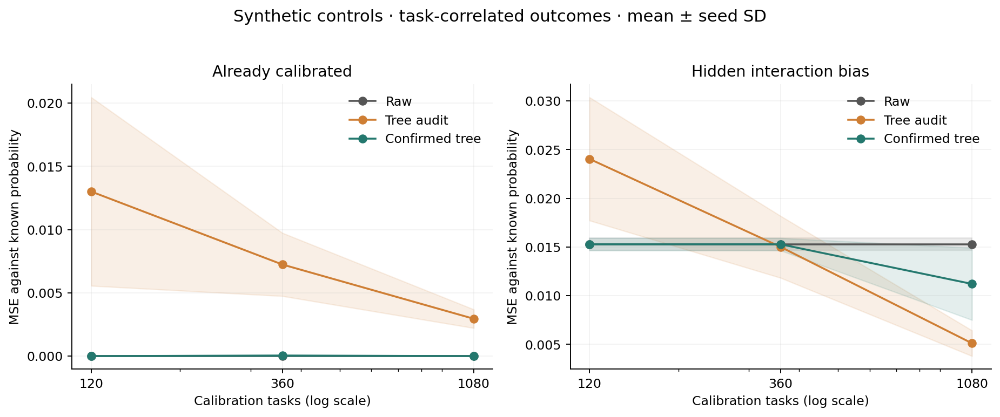

# Multicalibration for Coding Confidence

Tests whether corrections learned from miscalibrated subgroups improve confidence estimates for coding answers.

## Quick Start

Use Python 3.11 or 3.13. The [notebook](advanced_analysis.ipynb) includes saved outputs and reads the bundled numerical results offline.

```bash
git clone https://github.com/Smokeybear10/coding-confidence-calibration.git
cd coding-confidence-calibration
python -m venv .venv
source .venv/bin/activate
python -m pip install -r requirements.txt
jupyter lab advanced_analysis.ipynb
```

## Experiment

An overall calibration curve can hide errors within smaller groups. A tree can search for those groups, but choosing the largest observed error can also select noise. The question is whether a discovered correction survives a separate confirmation sample.

The data are recorded CALIBRI/LiveCodeBench outputs[^1]: 1,055 tasks, ten primary answers per task, and sixteen features describing token probabilities, code structure, size and missing outputs. Logistic regression and histogram gradient boosting each receive five treatments: raw scores, Platt scaling, fixed-group corrections, tree corrections, and tree corrections checked on fresh task blocks.

Three repeats of five outer folds keep all answers to a task together. Model fitting, Platt scaling, subgroup discovery, confirmation, routing selection and testing use separate task sets. [Methods](ADVANCED_METHODS.md) document the settings and splits.

## Findings

Raw logistic regression has the lowest mean Brier score in this configuration. Confirmed corrections produce nearly the same mean Brier as Platt scaling; the paired difference interval spans zero.

| Predictor / calibration | Mean Brier | Mean log loss |
| --- | ---: | ---: |
| Logistic / raw | 0.1087 | 0.3301 |
| Logistic / Platt | 0.1106 | 0.3368 |
| Logistic / fixed groups | 0.1143 | 0.3459 |
| Logistic / tree audit | 0.1113 | 0.3378 |
| Logistic / confirmed tree | 0.1105 | 0.3365 |
| Boosted / raw | 0.1111 | 0.3374 |

Lower is better. These are means across fifteen outer folds. The [full comparison](advanced_results/fold_metrics.csv) contains all ten pipelines, including calibrated boosted models.

One proposal illustrates the problem. In the first fold, answers with a function definition and scores between 0.4 and 0.6 appeared underconfident by 17 percentage points during discovery. The confirmation residual was -6.5 points, with a wide interval spanning zero. The filter rejected the correction. The notebook shows the complete proposal trace.

Synthetic controls make the noise measurable because the true probabilities are known. With 120 calibration tasks and already-calibrated scores, unconfirmed corrections add mean probability MSE of 0.0130; confirmation applies no correction. With a real interaction and 1,080 tasks, the unconfirmed auditor removes more error. Confirmation costs detection power.



A routing follow-up predicts how much an alternate answer helps, rather than using correctness confidence alone. Its value depends on the assumed failure and generation costs. [Routing results](ADVANCED_METHODS.md#escalation-benefit-and-decision-costs), [sample-budget curves](advanced_results/sample_complexity.csv) and [feature-mixture checks](advanced_results/mixture_shift.csv) are reported separately.

## Reproduce

```bash
python -m research.advanced --output work/new-advanced
python -m research.simulations --output work/new-simulations
python -m research.advanced_figures --results work/new-advanced --simulations work/new-simulations
python -m unittest discover -s research -t . -v
```

Use fresh output directories. Full runs save predictions, rules, split assignments, protocol snapshots and file hashes. `--smoke` runs one fold or one simulation seed.

## Scope

This is an exploratory public-data implementation of existing multicalibration ideas[^2][^3]. All benchmark experiments reuse an inspected sample. The 1,055 tasks remain the units of evidence across repeated fits. Bootstrap intervals are descriptive and omit refitting and shared-training dependence; confirmation establishes no population multicalibration guarantee. Costs are assumed, and empty-code extraction and publisher labels limit interpretation. These results do not evaluate a private Cursor deployment.

The [original analysis](analysis.ipynb), [original methods](METHODS.md), [reproduction record](REPRODUCIBILITY.md) and [raw-data walkthrough](reconstruction/cursor-confidence-walkthrough.ipynb) document the earlier single-split experiment and feature extraction.

[^1]: [CALIBRI](https://huggingface.co/datasets/lavis-nlp/CALIBRI), revision `7a4a7dc7aceb1b4a426c48761d0f128f2daf6a54`.
[^2]: Hebert-Johnson et al. (2018), [Multicalibration](https://proceedings.mlr.press/v80/hebert-johnson18a.html).
[^3]: Detommaso et al. (2024), [Multicalibration for Confidence Scoring in LLMs](https://proceedings.mlr.press/v235/detommaso24a.html).

Built by Thomas Ou
