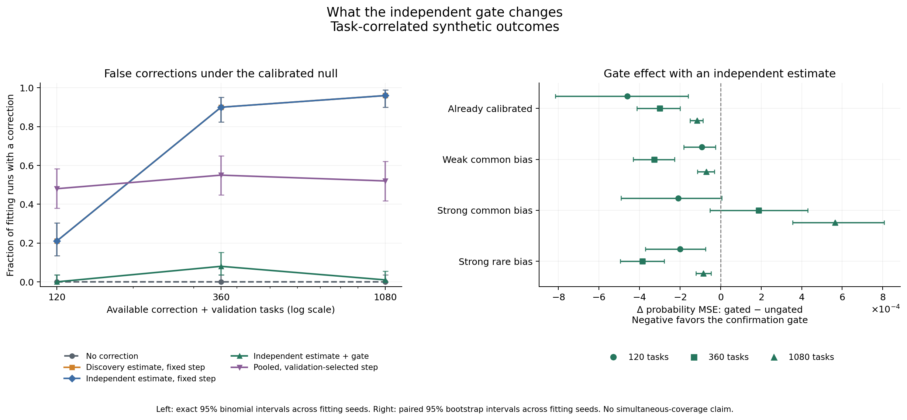

# Multicalibration for Coding Confidence

Predicts whether generated code passes benchmark tests, then checks whether subgroup calibration improves the probabilities or routing decisions.

## Quick Start

Start with [confirmation_analysis.ipynb](confirmation_analysis.ipynb). The three analysis notebooks have saved outputs and read the included results offline. Use Python 3.13 for fresh feature extraction; offline checks also run on Python 3.11.

```bash
git clone https://github.com/Smokeybear10/coding-confidence-calibration.git
cd coding-confidence-calibration
python -m venv .venv
source .venv/bin/activate
python -m pip install -r requirements.txt
jupyter lab confirmation_analysis.ipynb
```

## Experiments

L2 logistic regression uses sixteen token-likelihood, code-size and syntax-tree features. Platt scaling adjusts its scores; subgroup corrections target remaining gaps between predictions and pass rates. Data splits keep each task's ten answers together.

| Analysis | Question | Notebook / methods |
| --- | --- | --- |
| Fixed groups | Do overlapping group-and-score offsets improve on logistic and Platt? | [Original analysis](analysis.ipynb) / [methods](METHODS.md) |
| Learned groups and routing | Can a residual tree find useful corrections, and when does another model help? | [Advanced analysis](advanced_analysis.ipynb) / [methods](ADVANCED_METHODS.md) |
| Confirmation and shrinkage | Does checking a proposal on fresh tasks help beyond independently estimating it or shrinking the update? | [Controlled comparison](confirmation_analysis.ipynb) / [methods](CONFIRMATION_STUDY.md) |

The earlier learned-auditor comparison changed several things together. The controlled comparison holds one tree rule fixed and varies the estimation sample and confirmation gate. Four arms share task counts, support checks and step size. Three controls tune the step, including zero, on validation tasks; one learns its own rule using all available correction tasks.

| Evidence | Size | Purpose |
| --- | --- | --- |
| Recorded LiveCodeBench outputs[^1] | 1,055 tasks; five outer folds in the controlled comparison | Source comparison |
| Known-probability simulations | 24 settings; 100 fitting seeds each | Separate selected noise, genuine bias and task dependence |
| MultiPL-E Python outputs[^1][^2] | 161 tasks; ten answers each | Evaluate frozen source-trained pipelines |

The [protocol](research/confirmation_protocol.json) was versioned before the controlled comparison's evaluation runs. Available labels and per-policy label queries are recorded separately.

## Findings

Searching and estimating on the same data introduces error even when synthetic starting scores are calibrated. At budget 1,080 with task-shared label noise, probability MSE is 0.001064 with the reused estimate, 0.000118 with an independent estimate, and 0.000002 after confirmation.

With strong common bias and task-shared noise at that budget, confirmation rejects useful updates: gated minus ungated MSE is +0.000565, with a paired 95% interval of [0.000355, 0.000806]. With independent labels, the gate accepts every proposal. Pooled, validation-tuned updates perform better in both strong-bias cases at this budget.

On MultiPL-E, Platt without a subgroup update has the lowest observed Brier. The gate-versus-ungated independent-estimate interval spans zero: the benchmark check does not establish an improvement.

| Method | Source OOF Brier | External ensemble Brier |
| --- | ---: | ---: |
| Raw logistic | 0.1071 | 0.0775 |
| Platt / no subgroup update | 0.1100 | 0.0740 |
| Reused estimate / fixed step | 0.1090 | 0.0761 |
| Independent estimate / fixed step | 0.1095 | 0.0748 |
| Reused estimate / gate | 0.1098 | 0.0745 |
| Independent estimate / gate | 0.1098 | 0.0745 |
| Reused estimate / tuned step | 0.1104 | 0.0765 |
| Independent estimate / tuned step | 0.1093 | 0.0745 |
| Pooled auditor / tuned step | 0.1105 | 0.0750 |

Lower is better. Source numbers average held-out fold scores at budget 339; external numbers score a five-pipeline ensemble on MultiPL-E. The populations and prediction procedures differ. See paired intervals for [source](confirmation_results/source_contrasts.csv) and [external](confirmation_results/external_contrasts.csv) comparisons.



The [full grid](confirmation_results/simulation_summary.csv) includes all budgets and bias/dependence settings. With weak or rare task-shared bias, the gate mostly avoids damage by keeping the original scores.

## Reproduce

```bash
python -m research.external --output work/new-external --protocol research/confirmation_protocol.json
python -m research.confirmation_study --output work/new-confirmation --external work/new-external
python -m research.confirmation_figures --results work/new-confirmation
python -m unittest discover -s research -t . -v
```

Use fresh directories. Source and synthetic experiments run without `--external`; `--smoke` uses separate pilot seeds and skips external evaluation. The external adapter downloads about 46 MB of pinned public files. External records stay local; the repository publishes aggregate transfer results.

## Limits

Fresh splits and smaller updates already exist in multicalibration implementations.[^3] This comparison applies one correction under specified data budgets; it provides no iterative multicalibration guarantee.

The source sample was already inspected. Source intervals condition on overlapping fits and omit retraining uncertainty; external intervals condition on the frozen ensemble. Synthetic intervals use independent fitting seeds. Bootstrap confirmation is approximate, with no simultaneous-coverage claim. Model-training contamination and semantic benchmark overlap remain unchecked.

The Cursor fellowship ran May–July 2025, as listed on [thomasou.com](https://thomasou.com/). This repository contains later public-data experiments assembled in 2026. The [reproduction record](REPRODUCIBILITY.md) and [feature walkthrough](reconstruction/cursor-confidence-walkthrough.ipynb) document the archive and extraction, separately from private Cursor work.

[^1]: [CALIBRI](https://huggingface.co/datasets/lavis-nlp/CALIBRI), revision `7a4a7dc7aceb1b4a426c48761d0f128f2daf6a54`.
[^2]: [MultiPL-E](https://github.com/nuprl/MultiPL-E). Its pinned upstream conditions are recorded by the evaluation-only adapter.
[^3]: [MCBoost implementation guidance](https://mlr-org.github.io/mcboost/articles/mcboost_basics_extensions.html); further primary references are in [CONFIRMATION_STUDY.md](CONFIRMATION_STUDY.md).

Built by Thomas Ou
